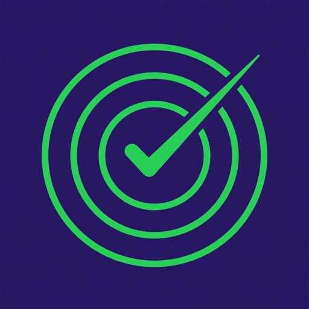
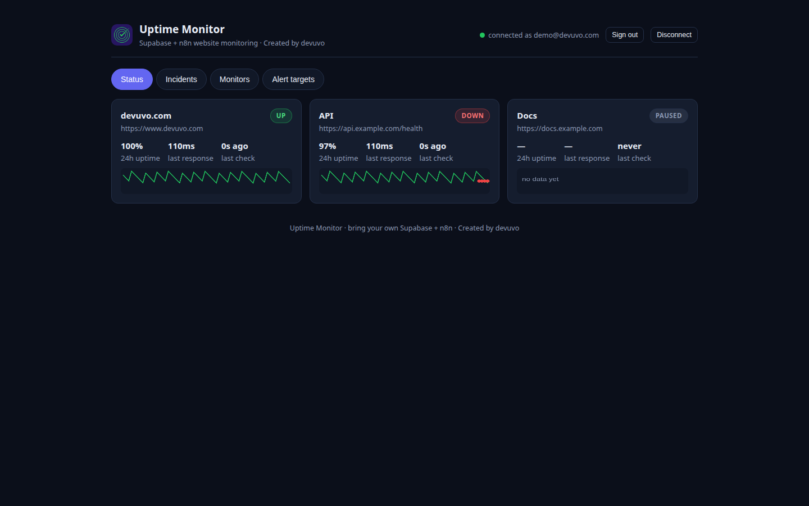
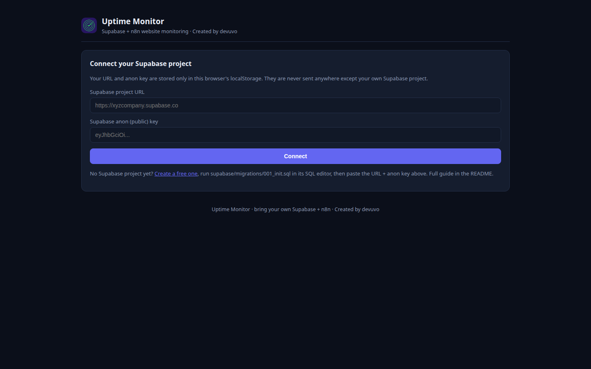
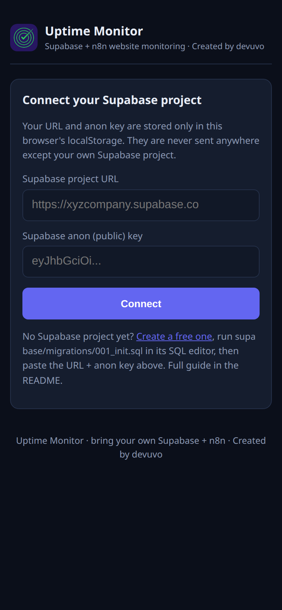

# Uptime Monitor

[](LICENSE)
[](supabase/migrations/001_init.sql)
[](n8n/)



*Created by devuvo*

A self-hostable website uptime monitor. **Supabase** stores your monitors, checks, incidents, and alert targets; **n8n** runs the checks every minute and dispatches Telegram/email/webhook alerts; a single-file **dashboard** shows live status. Bring your own credentials — nothing is hardcoded.





## Architecture

```
                    +------------------+
                    |  n8n (your host) |
                    |  check-runner    |-- every 1 min --> probes your sites
                    |  (Schedule)      |
                    +--------+---------+
                             | service_role key (bypasses RLS)
                             v
+-----------+        +-------+--------+        +------------------+
| dashboard |<------>|  Supabase      |<------>| alert-dispatcher |
| (browser) | anon   |  Postgres+RLS  |        | (n8n, on event)  |
|  + auth   |  key   |  + Realtime    |        +--------+---------+
+-----------+        +----------------+                 |
                                                        v
                                              Telegram / Email / Webhook
```

| Piece | What it does | Credential it needs |
|---|---|---|
| Dashboard (`dashboard/index.html`) | Status grid, incidents, monitor/alert management, live updates | Supabase URL + **anon** key (stored in your browser only) |
| n8n check-runner | Probes sites every minute, writes checks, opens/resolves incidents | Supabase **service_role** key (server-side, secret) |
| n8n alert-dispatcher | Sends DOWN/RECOVERED alerts to your targets | Telegram bot token, SMTP creds (in n8n), webhook URLs (per target) |

## Setup (no coding required)

### 1. Create a free Supabase project
Go to [supabase.com](https://supabase.com) → New project (free tier is plenty). Wait for it to provision.

### 2. Run the migration
Open **SQL Editor** → New query → paste the entire contents of `supabase/migrations/001_init.sql` → Run. This creates the `monitors`, `checks`, `incidents`, and `alert_targets` tables, row-level security (you only ever see your own rows), and enables realtime on checks/incidents.

(Optional) `supabase/seed.sql` inserts clearly-labeled demo rows so the dashboard isn't empty — replace `YOUR_USER_UUID` with your auth user id first, and delete them whenever you like.

### 3. Get your keys
**Project Settings → API**: copy the **Project URL**, the **anon public** key, and the **service_role** key (click *Reveal*). The service_role key bypasses all security rules — treat it like a password and never paste it into the dashboard.

### 4. Set up n8n
Use [n8n Cloud](https://n8n.io) (free trial) or self-host it. Then:
1. **Workflows → ⋯ → Import from file** → `n8n/check-runner.json`
2. Import `n8n/alert-dispatcher.json` the same way.
3. Create a **Supabase API** credential with your **service_role** key; attach it to every Supabase node in both workflows (the placeholders are named for you).
4. Create a **Telegram API** credential (bot token from @BotFather) and/or **SMTP** credential; attach to the matching send nodes in the dispatcher.
5. In the check-runner's two **Execute Workflow** nodes, select the imported alert-dispatcher workflow.
6. **Activate** the check-runner (toggle top-right). Leave the dispatcher inactive — it only runs when called.

### 5. Open the dashboard
Open `dashboard/index.html` in a browser — or deploy the `dashboard/` folder to GitHub Pages / Netlify / Vercel (it's static). Enter your Supabase URL + anon key, create an account, and add your first monitor. The n8n runner will start recording checks within a minute.

## How alerting works
- Check runner probes each active monitor when its `interval_minutes` have elapsed.
- A failed check (wrong status code, timeout, or connection error) with no open incident → opens an incident + fires a **DOWN** alert.
- A passing check while an incident is open → resolves it (recording downtime) + fires a **RECOVERED** alert.
- Alert targets (Telegram / email / webhook) are managed in the dashboard; n8n reads them per user at alert time.

## v2 — Mobile app

The dashboard is an installable app (PWA) — no app store needed:

- **Android:** open the dashboard in Chrome → menu (⋮) → **Install app** (or **Add to Home screen**). It launches full-screen like a native app.
- **iOS:** open the dashboard in Safari → **Share** → **Add to Home Screen**. Same standalone experience.

The app shell works offline once installed, but live status needs connectivity (it reads your Supabase project). Mobile notifications come through the alert targets you already configured — Telegram/email/webhook — so install Telegram on your phone and add your chat as a target for push-style DOWN alerts.

## Files

```
supabase/migrations/001_init.sql  schema, RLS, indexes, realtime
supabase/seed.sql                 optional demo rows
n8n/check-runner.json             scheduled probing + incident state machine
n8n/alert-dispatcher.json         Telegram / email / webhook fan-out
dashboard/index.html              single-file status dashboard (no build)
dashboard/manifest.json           PWA manifest (installable mobile app)
dashboard/sw.js                   service worker (offline app shell)
dashboard/icon-192.png            app icon 192px
dashboard/icon-512.png            app icon 512px (maskable)
dashboard/icon-180.png            Apple touch icon
.env.example                      every credential you need, with where it goes
assets/logo.png                   project logo
```

## Limitations
- n8n's free-tier execution limits bound how many monitors × frequency you can run; raise `interval_minutes` if you hit caps.
- HTTP checks only (no keyword/SSL-expiry assertions yet) — contributions welcome.
- The dashboard's realtime feed needs a websocket-friendly host; polling fallback is not included.
- Alert delivery depends on your n8n instance being up — for truly critical sites, run n8n somewhere reliable.

## License

**Free to use — just credit devuvo.** Personal, educational, and non-commercial use is free, provided you give visible credit (e.g. "Created by devuvo" with a link to https://www.devuvo.com). Business or income-generating use requires devuvo's prior approval — contact admin@devuvo.com (a license fee may apply). See [LICENSE](LICENSE) for the full terms.
